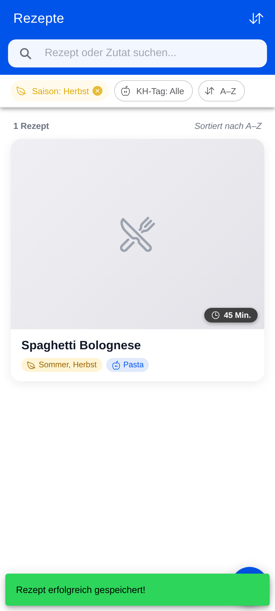
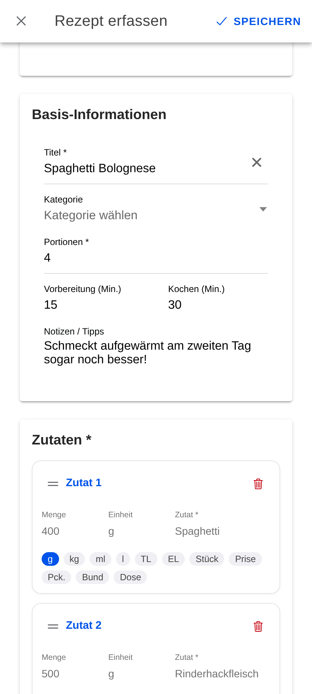
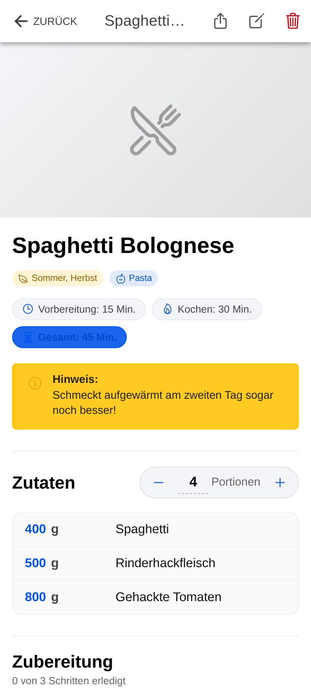
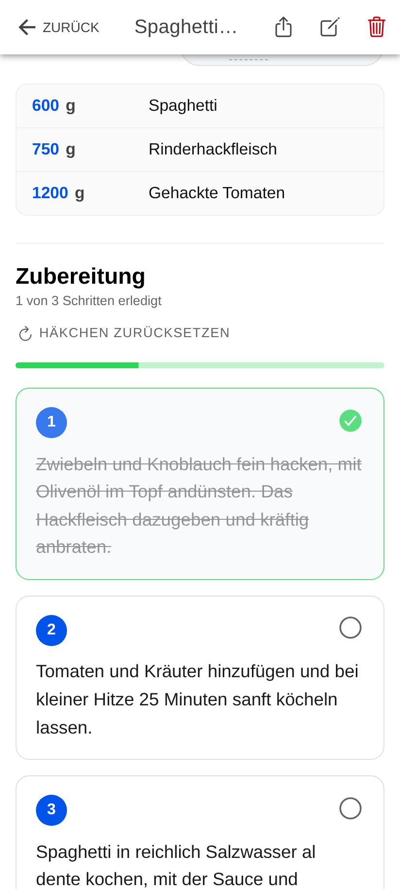

# rebu

<p align="center">
  <strong>Moderne, offline-first Rezept-App für Android, iOS und Web.</strong><br>
  Einfach, unabhängig und ohne Overhead – kein Account, kein Cloud-Zwang, 100 % deine Daten.
</p>

<p align="center">
  
  
  
  
  
  
</p>

---

## 📱 Screenshots

<p align="center">
  
  
  
  
</p>

<p align="center">
  <em>Rezept-Übersicht &middot; Intuitives Erfassen & Drag & Drop &middot; Detailansicht &middot; Interaktiver Kochmodus</em>
</p>

---

## ✨ Kernfunktionen

- 📝 **Einfaches Erfassen & Bearbeiten**:
  - Übersichtliches Formular für Titel, Portionen, Kochzeiten, Kategorien und Notizen.
  - Beliebig viele Zutaten und Zubereitungsschritte.
  - **Drag & Drop**: Zutaten und Schritte intuitiv per Gesten umsortieren (`@angular/cdk/drag-drop`).
  - **Auto-Save**: Automatisches Zwischenspeichern von Entwürfen schützt vor Datenverlust bei Unterbrechungen.
  - **Fotos**: Schnappschüsse direkt über die Kamera aufnehmen oder aus der Fotogalerie wählen.

- 👨‍🍳 **Interaktiver Kochmodus (Detailansicht)**:
  - **Echtzeit-Portionsskalierung**: Ändere die Portionszahl – alle Zutatenmengen passen sich sofort exakt und lesbar an.
  - **Schritte abhaken**: Durchgeführte Kochschritte interaktiv abhaken und durchstreichen, ohne den Überblick zu verlieren.
  - **Always-On-Display (Keep-Awake)**: Kein lästiges Entsperren mit mehligen Fingern – der Bildschirm bleibt während des Kochens aktiv.
  - Schneller Reset („Kochen beenden“) zum Zurücksetzen aller Häkchen.

- 🌿 **Intelligente Saisonalitätsberechnung**:
  - Integrierte mitteleuropäische Zutatendatenbank.
  - Ermittelt beim Speichern automatisch, in welchen Monaten ein Rezept saisonal ist.
  - Dashboard filtert standardmäßig nach der aktuellen Jahreszeit (Frühling, Sommer, Herbst, Winter) – jederzeit mit einem Klick umschaltbar.

- 🍝 **Automatische Kohlenhydrat-Erkennung (KH-Tags)**:
  - Erkennt anhand priorisierter Zutatenerkennung die Haupt-Kohlenhydratquelle (z. B. _Pasta, Reis, Kartoffeln, Brot/Teig, Hülsenfrüchte, Getreide_).
  - Ermöglicht gezieltes Filtern nach Beilagen und Ernährungspräferenzen.

- 🔄 **Dezentraler Austausch & Backup (Kein Server nötig)**:
  - **Natives Teilen**: Rezepte als formatierten Klartext direkt via WhatsApp, E-Mail, Messenger oder Notizen teilen.
  - **Datei-Export**: Einzelne Rezepte als `.rezept.json` exportieren und weitergeben.
  - **Sammel-Backup & Wiederherstellung**: Exportiere deine gesamte Rezeptsammlung inklusive Fotos (Base64) in eine Backup-Datei.
  - **Smarter Import**: Vorschau vor dem Speichern, automatische Konflikterkennung mit Wahl zwischen _Überschreiben_ oder _Als Kopie anlegen_.

- 🔒 **100 % Privatsphäre & Offline-First**:
  - Alle Rezepte, Bilder und Einstellungen verbleiben lokal auf deinem Gerät.
  - Keine Nutzerkonten, keine Registrierung, kein Tracking, kein Werbemüll.
  - Native SQLite-Datenbank sorgt für maximale Performance und Zuverlässigkeit auch im Funkloch.

---

## 🛠️ Technologie-Stack

| Bereich                | Technologien                                                                                                                                                                    |
| ---------------------- | ------------------------------------------------------------------------------------------------------------------------------------------------------------------------------- |
| **Framework & UI**     | [Angular 22](https://angular.dev/) (Standalone Components, Signals, Reactive Forms), [Ionic Framework 9](https://ionicframework.com/), [Ionicons 8](https://ionic.io/ionicons/) |
| **Mobile Runtime**     | [Capacitor 8](https://capacitorjs.com/) (`@capacitor/android`, `@capacitor/ios`, Camera, Filesystem, Share, Keep-Awake)                                                         |
| **Lokale Persistenz**  | `@capacitor-community/sqlite` (natives SQLite auf Android/iOS, `jeep-sqlite` & WebAssembly im Browser)                                                                          |
| **Styling**            | SCSS, CSS Custom Properties, Ionic Dark Mode & Themes                                                                                                                           |
| **Qualitätssicherung** | [Vitest](https://vitest.dev/) (280+ Unit-Tests), [ESLint 10](https://eslint.org/) (Flat Config), [Prettier](https://prettier.io/)                                               |
| **Automatisierung**    | [Husky](https://typicode.github.io/husky/), [commitlint](https://commitlint.js.org/), GitHub Actions CI/CD                                                                      |

---

## 📁 Repository-Struktur

```text
rebu/
├── .devcontainer/          # VS Code Dev-Container Konfiguration (inkl. Android SDK)
├── .github/
│   ├── workflows/          # GitHub Actions CI/CD (ci.yml, android.yml, release.yml)
│   ├── ISSUE_TEMPLATE/     # GitHub Issue-Vorlagen (Bug & Feature)
│   └── pull_request_template.md
├── android/                # Capacitor Android-Projekt (Gradle)
├── ios/                    # Capacitor iOS-Projekt (Xcode)
├── docker/                 # Build-Images für Container & CI
├── screenshots/            # App-Screenshots für Dokumentation
├── scripts/                # Hilfsskripte (z. B. Keystore-Generierung)
├── src/
│   ├── app/
│   │   ├── core/           # Services (Database, Repository, Share, Import, Saison, KH)
│   │   ├── data/           # Statische Datenbanken (Zutat-Saison, Zutat-KH)
│   │   ├── features/       # Feature-Pages (recipe-list, recipe-edit, recipe-detail, settings)
│   │   ├── models/         # TypeScript-Interfaces und Enums
│   │   └── shared/         # Wiederverwendbare UI-Komponenten (Badges, Chips etc.)
│   ├── assets/             # Statische Assets und WebAssembly-Dateien
│   └── theme/              # Farbvariablen & globales Styling
├── capacitor.config.ts     # Capacitor-Konfiguration
└── angular.json            # Angular CLI Konfiguration
```

---

## 🚀 Schnelleinstieg (Getting Started)

### Voraussetzungen

- **Node.js**: `>= 22.22` oder `>= 24.x`
- **npm**: `>= 10.x`
- _(Optional für Android)_: OpenJDK 17 oder 21, Android Studio & Android SDK (API Level 34+)
- _(Optional für iOS)_: macOS mit Xcode & CocoaPods

### Installation

1. **Repository klonen:**

   ```bash
   git clone https://github.com/pekarasa/rebu.git
   cd rebu
   ```

2. **Abhängigkeiten installieren:**

   ```bash
   npm ci
   ```

3. **Entwicklungsserver starten:**
   ```bash
   npm start
   ```
   Die Web-Version öffnet sich standardmäßig unter [http://localhost:4200](http://localhost:4200) (bzw. via Ionic CLI unter Port 8100). Im Browser wird SQLite transparent über `jeep-sqlite` / WASM simuliert.

---

## 📜 Verfügbare npm-Skripte

| Befehl                          | Beschreibung                                                              |
| ------------------------------- | ------------------------------------------------------------------------- |
| `npm start`                     | Startet den Angular Dev-Server für die Web-Entwicklung (`ng serve`)       |
| `npm run build`                 | Erstellt einen produktionsoptimierten Web-Build in `www/`                 |
| `npm test`                      | Führt Unit-Tests mit Vitest im Watch-Modus aus                            |
| `npm run test:ci`               | Führt alle Vitest Unit-Tests einmalig für CI aus                          |
| `npm run lint`                  | Prüft TypeScript- und HTML-Dateien mit ESLint                             |
| `npm run cap:sync`              | Synchronisiert den Web-Build mit den nativen Plattformen (`npx cap sync`) |
| `npm run build:android`         | Baut eine lokale Debug-APK (`android/app/build/outputs/apk/debug/`)       |
| `npm run build:android:release` | Baut eine signierte Release-APK                                           |
| `npm run keystore:generate`     | Interaktives Skript zum Erzeugen eines Android-Release-Keystores          |

---

## 📱 Mobile Builds (Android & iOS)

### Android Entwicklung

1. **Web-Assets bauen und mit Android synchronisieren:**

   ```bash
   npm run build
   npm run cap:sync
   ```

2. **In Android Studio öffnen:**

   ```bash
   npx cap open android
   ```

3. **Debug-APK über die Befehlszeile erstellen:**

   ```bash
   npm run build:android
   ```

4. **Release-APK signieren und bauen:**
   Generiere zuerst einen Keystore:
   ```bash
   npm run keystore:generate
   ```
   Erstelle anschließend die Datei `android/key.properties` (ist in `.gitignore`):
   ```properties
   storeFile=../android/release.keystore
   storePassword=DEIN_PASSWORT
   keyAlias=rebu-release
   keyPassword=DEIN_PASSWORT
   ```
   Führe den Release-Build aus:
   ```bash
   npm run build:android:release
   ```

### iOS Entwicklung

_Hinweis: iOS-Builds erfordern macOS und eine installierte Xcode-Umgebung._

```bash
npm run build
npx cap sync ios
npx cap open ios
```

---

## 🐳 VS Code & Devcontainer

Das Repository enthält eine vollständige Dev-Container-Umgebung unter `.devcontainer/`:

- **Komplettes Tooling**: Node.js 24, OpenJDK 17/21, Android SDK (Platform 34, Build-Tools) und CLIs vorkonfiguriert.
- **Schnellstart**: In VS Code über **„Dev Containers: Reopen in Container“** öffnen und sofort ohne lokale Installationen loslegen.
- **Port-Weiterleitungen**: `4200` (Angular Dev-Server), `8100` (Ionic Serve) und `35729` (LiveReload) sind vorkonfiguriert.
- **Empfohlene Extensions**: ESLint, Prettier, Angular Language Service, EditorConfig und Docker-Erweiterungen werden automatisch bereitgestellt.

---

## 🤖 CI/CD & Automatisierung

Das Projekt nutzt **GitHub Actions** für Qualitätssicherung und automatisierte Builds:

- **`ci.yml`**: Läuft bei jedem Push und Pull Request. Führt `npm ci`, ESLint, TypeScript-Typecheck, Vitest Unit-Tests und den Web-Produktions-Build aus.
- **`android.yml`**: Baut bei jedem Push auf `main` sowie bei PRs automatisch die Android-Debug- und (falls Secrets hinterlegt sind) Release-APKs und lädt sie als Workflow-Artefakte hoch.
- **`release.yml`**: Triggert bei Git-Tags (`v*`). Führt alle Qualitätsprüfungen durch, baut die signierten Android APKs und erstellt automatisch ein GitHub-Release mit den APK-Dateien als Download-Assets.

---

## 🗺️ Roadmap & Ausblick

Geplante Erweiterungen für zukünftige Meilensteine:

- [ ] **E2E-Tests**: Playwright-Testsuite für kritische Workflows (Erfassen → Kochen → Teilen → Importieren).
- [ ] **iOS CI/CD**: Automatisierter macOS-Runner-Workflow für iOS-Builds und Archivierung via GitHub Actions.
- [ ] **PDF-Export**: Druckfreundliche Formatierung für Rezeptkarten.
- [ ] **Store Release (`v1.0.0`)**: Vorbereitung der Store-Präsenzen für Google Play Store und Apple App Store.

---

## 🤝 Konventionen & Mitwirken

1. **Conventional Commits**: Commit-Nachrichten müssen dem Standard folgen (überwacht durch Husky & commitlint):
   - `feat: Neue Portionsberechnung hinzugefügt`
   - `fix: Fehler bei der Anzeige von Bildern im Dunkelmodus behoben`
   - `chore: Abhängigkeiten aktualisiert`
2. **Branching-Modell**: Trunk-based Development mit kurzlebigen Feature-Branches (`feature/<titel>`) und Squash-Merges in `main`.
3. **Pull Requests**: Bitte stelle vor dem Einreichen sicher, dass:
   ```bash
   npm run lint
   npx tsc -p tsconfig.app.json --noEmit
   npm run test:ci
   npm run build
   ```
   erfolgreich durchlaufen.

---

## 📄 Lizenz

Dieses Projekt ist für den privaten und mobilen Gebrauch entwickelt. Alle Rechte vorbehalten.
